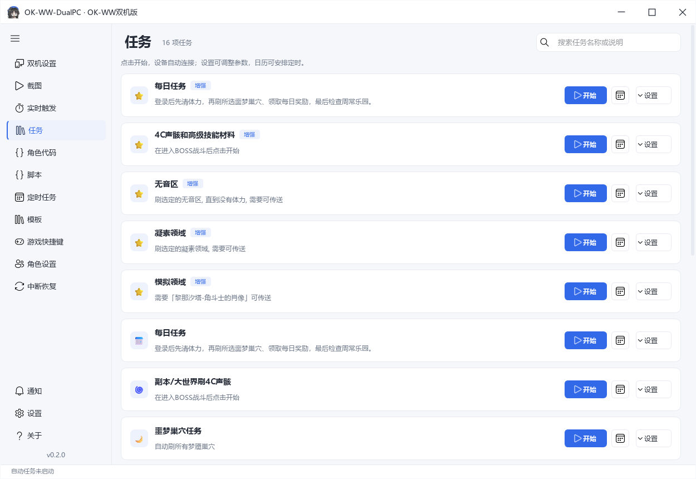

# OK-WW-DualPC · OK-WW双机版

鸣潮双机自动化工具，支持自动战斗、一键日常、声骸副本循环和角色代码工坊。

游戏在游戏机上运行，控制机通过采集卡识别画面，通过 KMBox Net 或 MAKCU 发送键鼠操作。主程序、内置任务和角色连招使用 C++，工坊与通用脚本使用独立 Python 环境。

基于 [OK-WW](https://github.com/ok-oldking/ok-wuthering-waves)、[OK-WW Enhanced](https://github.com/zzc-tongji/ok-ww-enhanced) 和 [ok-script](https://github.com/ok-oldking/ok-script) 开发。当前版本为 **0.2.0 预览版**，支持 Windows x64。

[下载完整包](https://github.com/xueyuannnn/OK-WW-DualPC/releases) · [使用说明](docs/usage.md) · [问题反馈](https://github.com/xueyuannnn/OK-WW-DualPC/issues)



## 主要功能

- **双机设置**：一次检测采集设备及支持参数，选择分辨率、帧率和图像格式；配置盒子连接，测试鼠标移动，调整移动倍率。参数修改后自动保存，连接时应用。
- **自动战斗**：识别当前队伍，支持 57 名内置角色，按队伍选择内置连招或 Python 工坊连招。运行栏显示队伍、当前角色和代码模式。
- **每日任务**：清理体力、刷噩梦巢穴、检查周常乐园；可设置体力补充、任务重试与中断恢复。
- **副本循环**：4C 声骸、无音区、凝素领域、模拟领域和高级技能材料。4C 可设置副本顺序、起始分类与位置、每个副本的轮数。
- **周常乐园**：设置流派偏好，按推荐标记和品质选卡，检查战斗技能，商店购买时保留指定数量的货币。
- **声骸管理**：声骸合成、强化调谐和主属性重构。
- **角色工坊**：按队伍、作者和版本查找方案，查看三人头像和使用说明；导入、编辑、导出队伍代码，定期同步代码库，已下载内容可离线使用。
- **脚本与录制**：编写 Python 任务，录制预览区域内的键鼠操作，设置次数或持续循环，导入导出 `.okscript` 脚本包；提供中文动作模板和图片标注工具。
- **任务管理**：图形化参数、定时计划、实时触发、日志、通知和已保存账号的多账号日常。实时触发的开关与参数修改后自动保存。
- **画面预览**：等比显示、独立窗口、窗口置顶；预览帧率可选 30 / 60 / 120 / 144 / 165 / 240 / 无限制。

## 运行方法

下载 `OK-WW-DualPC-full.zip`，完整解压后运行 `OKWW-DualPC-Native-Dev.exe`。运行库、识别模型和工坊环境都在包内，不需要另装 Python。

1. 在游戏机打开鸣潮，确认采集卡能收到游戏画面。
2. 打开「双机设置」，点击「检测设备与参数」，选择采集卡、分辨率、图像格式和帧率。
3. 选择盒子类型，填写连接参数。普通包默认开启演练模式；确认设备后关闭演练模式，才能发送实际键鼠操作。
4. 在「实时触发」启用需要的功能，再点击「双机设置」右上角的「开始」。也可以在「任务」页直接开始指定任务，软件会先连接设备。
5. 按 **F9** 暂停或继续任务。任务页「停止」结束当前任务并保留连接；双机设置右上角「停止」才断开设备。准备期间可点击「取消启动」。

只看画面或测试盒子时，展开「双机设置 → 设备调试」，选择「仅连接预览」。退出软件请右键系统托盘图标，选择「退出」。

[使用说明](docs/usage.md) · [设备与预览](docs/devices.md) · [角色代码工坊](docs/workshop.md) · [脚本与模板](docs/scripts.md)

## 设备支持

| 模块 | 支持范围 |
| --- | --- |
| 系统 | Windows x64 |
| 采集 | DirectShow、Media Foundation |
| 盒子 | KMBox Net、MAKCU V4 串口 |
| 图像参数 | 按采集卡驱动枚举结果选择 |
| 预览帧率 | 独立于采集帧率设置 |

MAKCU 的键盘输出取决于固件和路由配置。暂不支持 FFmpeg 采集和 P010 格式。盒子发送的是输入指令，无法读取游戏机上的实际鼠标位置。

采集卡列出的帧率是驱动支持的模式，实际收帧率请以软件状态栏为准。预览帧率、采集帧率和游戏帧率分别设置。

## 工坊与脚本格式

| 文件 | 导入位置 | 用途 |
| --- | --- | --- |
| `.zip` | 角色代码 | OK-WW / OK-WW-E 标准 Python 队伍包 |
| `.okww-team` | 角色代码 | 按本项目接口编译打包的 C++ 队伍模块 |
| `.okscript` | 脚本 | 通用 Python 任务及资源 |

单独的 `.cpp`、`.c` 文件和任意 DLL 不能作为队伍包导入。工坊使用原有角色接口；依赖额外 Python 库、直接调用本机键鼠或使用尚未支持角色的代码，需要单独适配。

切换代码前先暂停任务。切回内置连招会保留导入副本，之后可以再次启用工坊代码。切换在后台完成，界面会显示进度；首次加载工坊环境需要稍等。

请只导入可信代码，Python 工坊进程具有普通进程权限。自动同步只更新代码库，导入后才会更改当前队伍。

## 问题反馈

联系邮箱：[lidada0202@gmail.com](mailto:lidada0202@gmail.com)。软件「关于」页也可复制地址或打开邮件客户端。

反馈时请附上软件版本、任务名称、采集卡与盒子型号、复现步骤和相关日志。工坊问题请同时说明队伍、方案作者及版本。发送前请检查并隐藏设备凭据和个人信息。

当前为预览版，不同采集卡、盒子固件和游戏版本的表现可能不同。模块与离线测试不能替代实际设备和游戏内测试。

## 开发

主程序使用 C++20 / Qt 6，图像识别使用 OpenCV 与 OpenVINO。构建环境和测试方法见[开发说明](docs/development.md)，代码目录见 [native/README.md](native/README.md)。

```powershell
.\Build-Native.ps1 -QtRoot C:\Qt\6.8.3\msvc2022_64 `
    -OpenCvRoot C:\SDK\opencv\build -OpenVinoRoot C:\SDK\openvino -Test
```

个人配置保存在程序旁的 `native-full-data/`。更新前建议备份此目录，请勿将其中的设备配置、导入队伍和日志提交到公开仓库。

## 相关项目

- [OK-WW](https://github.com/ok-oldking/ok-wuthering-waves)：原版鸣潮自动化项目。
- [OK-WW Enhanced](https://github.com/zzc-tongji/ok-ww-enhanced)：任务与角色扩展，[版本发布](https://github.com/zzc-tongji/ok-ww-enhanced/releases)。
- [ok-script](https://github.com/ok-oldking/ok-script)：Python 自动化框架。
- [角色工坊镜像](https://github.com/yamadafz/ok-ww-char-code)：社区保存的原工坊快照，当前默认同步来源。

来源版本和组件许可见 [THIRD-PARTY-DUALPC.md](THIRD-PARTY-DUALPC.md)。

## 许可

本项目免费开源，应用代码遵循 [AGPL-3.0](LICENSE.txt)。第三方代码和游戏素材保留各自的许可与版权。

本项目与游戏官方无关联。使用自动化功能可能带来账号风险，请了解游戏相关规则后使用。
