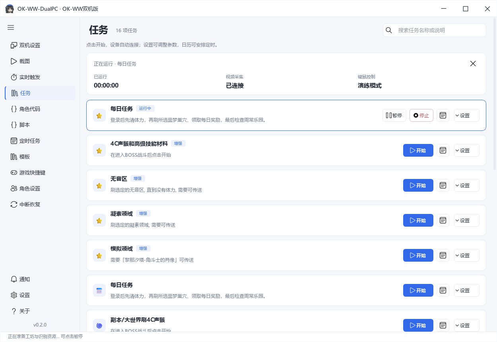
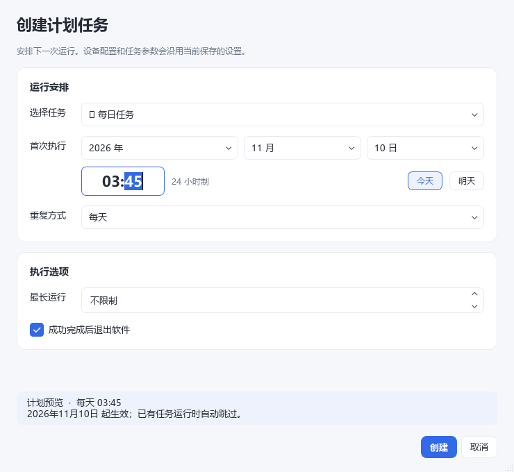

# 使用说明

## 软件更新

在「关于 → 版本更新」检查本项目的 GitHub Releases，可查看新版本摘要，再点击「下载并更新」。默认启动时自动检查，并包含预览版；这两项均可关闭。检查不会上传配置或导入的代码。

更新包通过 SHA256 校验、解压和文件检查后，软件保存配置并退出，完成替换后重新打开，设备和任务保持停止。`native-full-data`、工坊队伍与自定义脚本保留。下载或准备失败不会替换程序；安装失败会尝试恢复本次修改的文件，日志保存在安装目录 `.updates` 中。

网络受限时可点击「关于」中的本项目 GitHub 地址手动下载完整包。源码构建目录不执行自动替换。不要把更新包解压到现有目录后只复制 EXE，运行库和工坊引擎需要一并更新。

## 启动和暂停

「截图」页是总控与诊断入口，可查看采集状态、保存截图、预览画面和启动实时任务。

导航第一项是「双机设置」，第二项是「截图」，打开软件默认进入双机设置。右上角的「开始」自动连接采集卡和盒子，确认有画面且盒子支持键盘输入后，再运行已勾选的实时任务。在「任务」页点击具体任务的「开始」，会完成同样的设备准备并运行该任务。已连接且配置未变时复用现有连接。

设备运行时，双机设置右上角按钮显示「停止」，点击后结束线程、释放按键并断开采集卡与盒子。普通任务完成，或在任务卡片点击「暂停」「停止」后，只退出当前任务，已启用的实时触发继续运行；采集卡、预览和盒子保持连接。任务卡片的「暂停」后可点击「开始」重新执行该任务。F9 是全局暂停或继续，会同时影响当前任务与实时触发，但保留设备连接。

短暂漏识别、输入焦点丢失或桌面采集失效时，程序显示恢复状态，恢复后继续当前任务。只有恢复超过上限或设备持续失联时才显示「异常已暂停」，保存现场并提供「重试任务」；可复用正常的设备连接。「终止线程」用于断开设备。

右键系统托盘图标，选择“退出”即可结束软件；主窗口隐藏或最小化时同样有效。设备操作或脚本保存尚未结束时会自动等待，未保存的脚本可选择保存、放弃或取消退出。

准备过程中按钮显示「取消启动」。从任务卡片取消时，尚未结束的连接操作会先完成，然后运行已启用的实时触发，不会启动已取消的普通任务。按 F9 取消会保留连接并暂停全部自动操作。从双机设置右上角取消时会在连接操作完成后断开设备。设备失败会显示原因。

自动战斗需在「实时触发」启用，并进入可识别的战斗场景。「双机设置」的「设备调试」默认收起；「仅连接预览」供只看画面、校准鼠标或测试盒子使用，不运行自动任务。正常运行无需先操作设备调试。

识别资源在打开软件后由后台提前加载，连接设备和再次启动时复用。工坊代码合并检查，内容未变化时复用成功结果；修改代码后重新检查。首次准备尚未完成时会显示进度，界面仍可操作，按 F9 可暂停。

日志分别记录设备连接与任务准备的耗时；设备保持连接时会记录复用连接，便于区分采集卡握手等待与脚本准备。

修改盒子、队伍代码和校准鼠标前先暂停。连接线程停止后，自动输入也会停止。

## 本机截图与输入

采集卡格式固定为 NV12，检测后仅列出 NV12 支持的分辨率与帧率。手动采集参数同样使用 NV12。

在「双机设置」中选择采集方式：采集卡、DXGI 或 Win32。DXGI 默认采集主显示器，帧率默认跟随显示器刷新率；多屏时可在视频采集的「高级设置 → DXGI 采集显示器」中切换。DXGI 和 Win32 的采集帧率均可在主面板选择或直接输入（1–1000）。Win32 默认采集主显示器；需要指定窗口时，展开视频采集的「高级设置」，在「Win32 截图目标」中选择。窗口截图只取客户区，窗口需保持可见，不能最小化。改变窗口尺寸或显示模式后重新连接。

若使用远程软件，请开启远程软件的全屏模式，并确保游戏画面为 16:9 全屏。

「输入方式」可选 KMBox Net 或 SendInput。SendInput 默认直接向当前前台窗口发送输入。需要指定窗口时，展开键鼠控制的「高级设置」，选择「SendInput 窗口」；该窗口不在前台时等待，焦点恢复后自动续跑。选回「当前前台窗口（默认）」后恢复跟随当前操作窗口。远程软件是否转发输入、游戏是否接收软件输入，需自行确认；目标程序和本软件需具有相同权限。

两处选择互相独立，切换后保留各模式已填参数，修改自动保存，下次连接时应用。通常双机使用「采集卡 + KMBox Net」，本机使用「DXGI / Win32 + SendInput」。

预览录制通过 KMBox 向远端转发操作，目前不用于 SendInput；SendInput 可直接运行已编辑或导入的脚本。

## 参数保存

选择列表默认在控件下方展开，长列表可滚动，靠近屏幕边缘时限制高度并避让。可编辑的列表保留手动输入。

有明确范围的参数提供滑块与数值框，例如体力魔方上限、任务恢复次数和周常商店保留货币；鼠标倍率、等待间隔和超时也可拖动调整。两种输入互相同步，输入框保留原有精度和取值范围。

实时触发页的开关、选项和列表修改后立即保存；数值、文本和多行内容停止输入后自动保存，无需点击保存或移开焦点。参数区显示保存状态，离开输入框或退出软件前会保存待写入的有效修改。JSON 输入不完整时保留上一次有效配置，并提示尚未保存。运行中的自定义实时脚本从下一次触发使用新参数。

其他任务参数在编辑完成或松开滑块后保存到当前数据目录。设备参数在点击「开始」或「应用配置」时生效。角色代码需要点击保存。数值框、滑块和下拉框不会因滚轮滑动而修改值。

「双机设置」的参数修改后自动保存，无需点击保存按钮。包括采集卡与参数选择、手动采集、裁剪、识别分辨率、盒子连接和鼠标移动设置；预览参数也会单独保存。输入未完成时保留草稿，连接前会检查参数。顶部显示保存状态，退出时保存尚未写入的修改。已连接的设备在点击「开始」或「仅应用设备配置」后使用新参数。

默认数据目录为程序旁的 `native-full-data/`，其中 `native-device-settings.json` 保存界面中的设备参数与草稿，`dualpc.json` 保存上次校验并应用的设备配置，`configs-dualpc/` 保存任务和队伍配置。更换版本前可备份这个目录；不要把它上传到公开仓库。开发运行时可用 `--data` 指定另一个目录。

## 常用任务

每日任务达到 100 活跃度并领奖后，继续完成配置的副本额度，体力与备用体力不足时结束。无音区次数按每份 60 体力计算，双倍领取计两次，补每日目标已刷的份数也计入总额度。优先双倍时，剩余次数或体力只够一份才单倍领取；体力魔方仅用于补完每日目标，每天最多使用 4 个。

任务页可按名称或说明搜索，清空关键词后恢复原任务顺序。标记“增强”的任务与同名基础任务可直接区分。蓝色“开始”连接设备并运行任务，运行时显示“暂停”和“停止”；右侧日历设置定时，“设置”展开参数。运行信息集中显示计时、采集与键鼠连接状态。

- 每日任务先检查目标并领取可用奖励，按需补体力目标或获取声骸，达到 100 活跃度后先领奖，再执行剩余副本次数、整批聚落清理和周常等附加任务。只缺声骸时可先刷残像聚落；补目标时刷过的副本计入配置次数。体力魔方仍受原有开关及每日上限控制。无法确认每日目标完成时，保留诊断并停止进入附加流程。
- 每日任务开始时列出完整执行清单，包括每日目标、领奖及已启用的附加项目。信息栏显示已完成、剩余、跳过和未完成项数，以及按项目统计的总进度。每项提供参考耗时，有本机成功运行记录后改用最近记录估算；失败、等待重试及持续循环不显示虚假的完成时间。
- 4C 声骸循环可设置副本顺序、从战歌重奏或讨伐强敌的指定位置开始，以及每个副本刷几轮再切换。
- 周常乐园可设置流派、推荐与品质优先级、商店保留货币和技能检查。
- 声骸合成、强化调谐和主属性重构会改变道具或消耗材料，启动前检查筛选与次数。
- 定时任务可在同一张表单中选择任务、首次执行时间、重复方式、运行时限和完成后退出。列表提供修改、启用/停用及删除；修改停用的计划后仍保持停用。到点会自动连接设备，按当前保存的任务参数运行；已有任务正在执行时会跳过此次计划。需保持 Windows 已登录、游戏已打开、设备可用。

日期使用年、月、日三个下拉框，自动适配大小月和闰年；提供“今天 / 明天”快捷选择。时间独立输入，使用 24 小时制，底部实时预览执行安排。数值框的加减按钮分别生效，保留键盘输入，鼠标滚轮不会改变数值。

## 中断恢复

战斗界面短暂丢失时，会释放按键、等待队伍界面恢复并继续当前战斗；已确认的外部运行弹窗会尝试关闭。SendInput 焦点或 Win 键状态暂时异常时等待恢复，DXGI、Win32 临时失效时自动重建采集，期间保留当前任务和设备线程。界面显示恢复状态与等待时间。超过恢复上限或设备持续失联时，保存现场并提示原因。

每日任务、无音区、凝素领域和模拟领域的设置中可选择「副本奖励领取」。默认「优先双倍」，体力和剩余额度足够时领取两份，最后一份或体力不足时单倍；双倍计入两次领取额度。选择「仅单倍」可恢复每轮一份。每日补体力目标每轮最多领取两份，随后检查每日进度并优先领奖。

## 无法接管时

依次检查采集是否持续更新、盒子是否连接并支持键盘输出、任务是否暂停、自动战斗是否启用。工坊连招异常时，先确认队伍处于工坊模式，再检查日志中的 Python 错误和输入能力提示。

## 通用脚本与模板

在“脚本”页面编辑、录制、循环运行或导入原版 `.okscript` 包，使用方式见[脚本教程](scripts.md)。图像标注和资源发布在“模板”页面。角色队伍连招在“角色代码”页面，其工坊支持联网同步、可配置更新周期和离线选择，见[工坊教程](workshop.md)。

## 界面与脚本动作

界面提供浅色、深色和跟随系统明暗设置，统一使用蓝色主操作、细边框卡片和分层说明。原有导航、任务入口和快捷键保持一致；二级编辑窗口可调整大小，长表单支持滚动。

「脚本」的动作库提供 81 个中文动作，涵盖键鼠、等待、图像识别、文字识别、日志、区域及窗口操作。双击动作可配置中文参数后插入代码；常用项直接显示，高级项折叠。开关和鼠标按键使用选择控件，数字支持精确输入，数值参数也可切换表达式。生成的函数名、参数键和默认值沿用原接口。

DXGI 和 Win32 会复用内容未变化的画面，减少重复转换；连接检查仍持续进行，静止画面不会被当成断开。采集实测帧率统计更新的画面，可能低于显示器刷新率或设置的采集频率。

## 活动任务

在游戏中打开「拉海洛方块·逆转」关卡列表或「第二索拉：未名之梦」活动页，再开始对应任务。两项活动目前支持简体中文、16:9 画面，沿用双机设置中的采集和输入方式。拉海洛方块会校验落点预览再松开鼠标；第二索拉从当前旅程继续推进并领取可用活动奖励。

## 多账号独立配置

展开「多账号日常」，打开「启用账号独立每日配置」，点击「配置账号」。账号名按游戏登录框中的显示内容填写，包括星号；选中账号后可直接修改每日参数。未配置的账号沿用「每日任务」参数。

独立配置或体力魔方功能开启时，任务会先重新登录一次确认当前账号。魔方计数按账号及每日 4 点重置，每个账号每天最多 4 个，只在每日目标未完成时使用。旧共用计数仅迁移给首次确认的账号一次；未知账号身份时沿用旧计数，不推断账号。

## 浏览器云游戏

「设置 → 云游戏与远程画面」可打开云·鸣潮网页，优先使用 Edge 的 1080p 全屏和 SDR 色彩参数。自行登录后，选择 DXGI / Win32 采集和 SendInput 输入，并开启「浏览器云游戏模式」。该模式使用云游戏锁敌识别和 1020 / 4012 断线处理。远程软件中的普通 PC 客户端只需使用「压缩画面识别容错」，无需开启浏览器云游戏模式。
