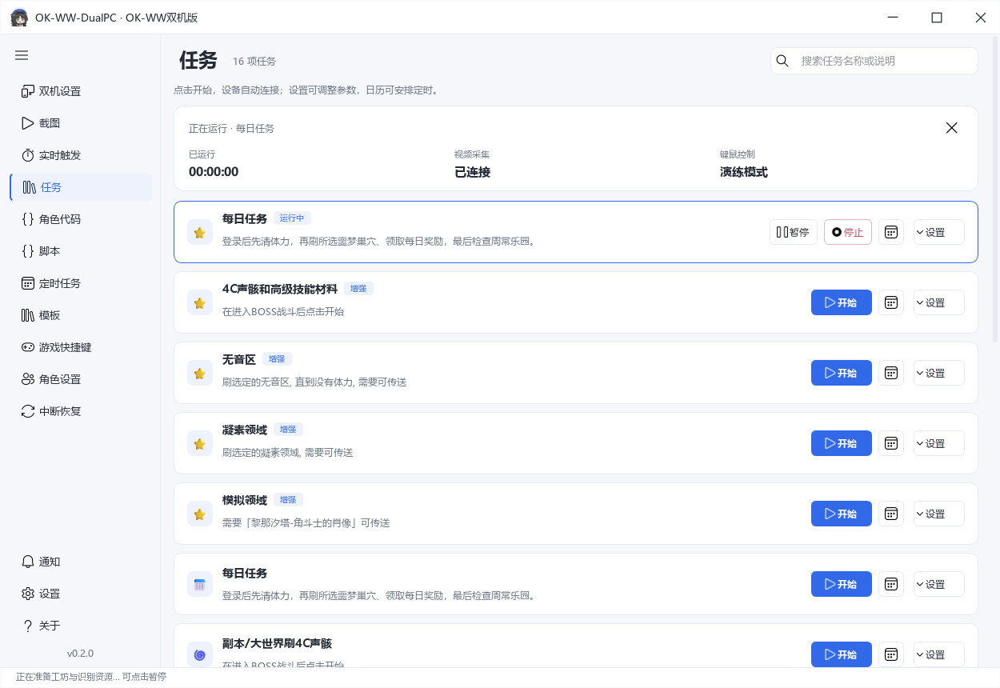
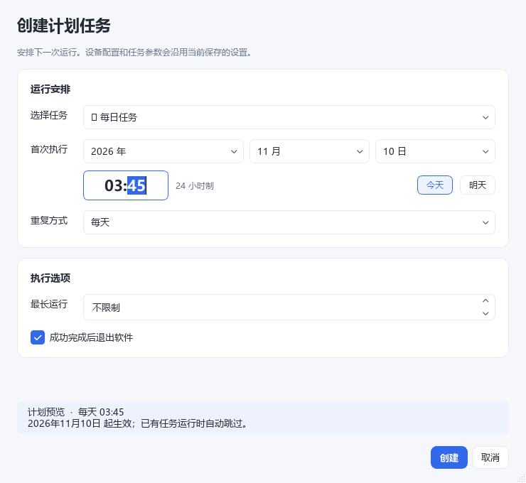

# 使用说明

## 启动和暂停

「截图」页是总控与诊断入口，可查看采集状态、保存截图、预览画面和启动实时任务。

导航第一项是「双机设置」，第二项是「截图」，打开软件默认进入双机设置。右上角的「开始」自动连接采集卡和盒子，确认有画面且盒子支持键盘输入后，再运行已勾选的实时任务。在「任务」页点击具体任务的「开始」，会完成同样的设备准备并运行该任务。已连接且配置未变时复用现有连接。

设备运行时，双机设置右上角按钮显示「停止」，点击后结束自动任务、释放按键并断开采集卡与盒子。任务卡片的「停止」只结束当前任务并释放按键，采集卡、预览和盒子保持连接，下一次任务直接复用。「暂停」和运行中的 F9 也保留设备连接。

右键系统托盘图标，选择“退出”即可结束软件；主窗口隐藏或最小化时同样有效。设备操作或脚本保存尚未结束时会自动等待，未保存的脚本可选择保存、放弃或取消退出。

准备过程中按钮显示「取消启动」。从任务卡片取消或按 F9 取消时，尚未结束的连接操作会先完成并保留连接，不会随后启动任务。从双机设置右上角取消时会在连接操作完成后断开设备。设备失败会显示原因。

自动战斗需在「实时触发」启用，并进入可识别的战斗场景。「双机设置」的「设备调试」默认收起；「仅连接预览」供只看画面、校准鼠标或测试盒子使用，不运行自动任务。正常运行无需先操作设备调试。

识别资源在打开软件后由后台提前加载，连接设备和再次启动时复用。工坊代码合并检查，内容未变化时复用成功结果；修改代码后重新检查。首次准备尚未完成时会显示进度，界面仍可操作，按 F9 可暂停。

日志分别记录设备连接与任务准备的耗时；设备保持连接时会记录复用连接，便于区分采集卡握手等待与脚本准备。

修改盒子、队伍代码和校准鼠标前先暂停。连接线程停止后，自动输入也会停止。

## 参数保存

选择列表默认在控件下方展开，长列表可滚动，靠近屏幕边缘时限制高度并避让。可编辑的列表保留手动输入。

有明确范围的参数提供滑块与数值框，例如体力魔方上限、任务恢复次数和周常商店保留货币；鼠标倍率、等待间隔和超时也可拖动调整。两种输入互相同步，输入框保留原有精度和取值范围。

实时触发页的开关、选项和列表修改后立即保存；数值、文本和多行内容停止输入后自动保存，无需点击保存或移开焦点。参数区显示保存状态，离开输入框或退出软件前会保存待写入的有效修改。JSON 输入不完整时保留上一次有效配置，并提示尚未保存。运行中的自定义实时脚本从下一次触发使用新参数。

其他任务参数在编辑完成或松开滑块后保存到当前数据目录。设备参数在点击「开始」或「应用配置」时生效。角色代码需要点击保存。数值框、滑块和下拉框不会因滚轮滑动而修改值。

「双机设置」的参数修改后自动保存，无需点击保存按钮。包括采集卡与参数选择、手动采集、裁剪、识别分辨率、盒子连接、演练模式和鼠标移动设置；预览参数也会单独保存。输入未完成时保留草稿，连接前会检查参数。顶部显示保存状态，退出时保存尚未写入的修改。已连接的设备在点击「开始」或「仅应用设备配置」后使用新参数。

默认数据目录为程序旁的 `native-full-data/`，其中 `native-device-settings.json` 保存界面中的设备参数与草稿，`dualpc.json` 保存上次校验并应用的设备配置，`configs-dualpc/` 保存任务和队伍配置。更换版本前可备份这个目录；不要把它上传到公开仓库。开发运行时可用 `--data` 指定另一个目录。

## 常用任务

任务页可按名称或说明搜索，清空关键词后恢复原任务顺序。标记“增强”的任务与同名基础任务可直接区分。蓝色“开始”连接设备并运行任务，运行时显示“暂停”和“停止”；右侧日历设置定时，“设置”展开参数。运行信息集中显示计时、采集与键鼠连接状态。

- 每日任务按清体力、巢穴、周常检查等步骤运行。体力补充受对应开关和使用上限控制。
- 4C 声骸循环可设置副本顺序、从战歌重奏或讨伐强敌的指定位置开始，以及每个副本刷几轮再切换。
- 周常乐园可设置流派、推荐与品质优先级、商店保留货币和技能检查。
- 声骸合成、强化调谐和主属性重构会改变道具或消耗材料，启动前检查筛选与次数。
- 定时任务可在同一张表单中选择任务、首次执行时间、重复方式、运行时限和完成后退出。列表提供修改、启用/停用及删除；修改停用的计划后仍保持停用。到点会自动连接设备，按当前保存的任务参数运行；已有任务正在执行时会跳过此次计划。需保持 Windows 已登录、游戏已打开、设备可用。

日期使用年、月、日三个下拉框，自动适配大小月和闰年；提供“今天 / 明天”快捷选择。时间独立输入，使用 24 小时制，底部实时预览执行安排。数值框的加减按钮分别生效，保留键盘输入，鼠标滚轮不会改变数值。

## 中断恢复

中断恢复会尝试处理已支持的弹窗、角色死亡及部分任务中断，并受重试次数限制。未知界面、持续断帧和设备失联仍可能停止任务。查看日志里的最后一步，通常比反复点击开始更容易确定原因。

## 无法接管时

依次检查采集是否持续更新、演练模式是否关闭、盒子是否连接、任务是否暂停、自动战斗是否启用。工坊连招异常时，先确认队伍处于工坊模式，再检查日志中的 Python 错误和输入能力提示。

## 通用脚本与模板

在“脚本”页面编辑、录制、循环运行或导入原版 `.okscript` 包，使用方式见[脚本教程](scripts.md)。图像标注和资源发布在“模板”页面。角色队伍连招在“角色代码”页面，其工坊支持联网同步、可配置更新周期和离线选择，见[工坊教程](workshop.md)。

## 界面与脚本动作

界面提供浅色、深色和跟随系统明暗设置，统一使用蓝色主操作、细边框卡片和分层说明。原有导航、任务入口和快捷键保持一致；二级编辑窗口可调整大小，长表单支持滚动。

「脚本」的动作库提供 81 个中文动作，涵盖键鼠、等待、图像识别、文字识别、日志、区域及窗口操作。双击动作可配置中文参数后插入代码；常用项直接显示，高级项折叠。开关和鼠标按键使用选择控件，数字支持精确输入，数值参数也可切换表达式。生成的函数名、参数键和默认值沿用原接口。

