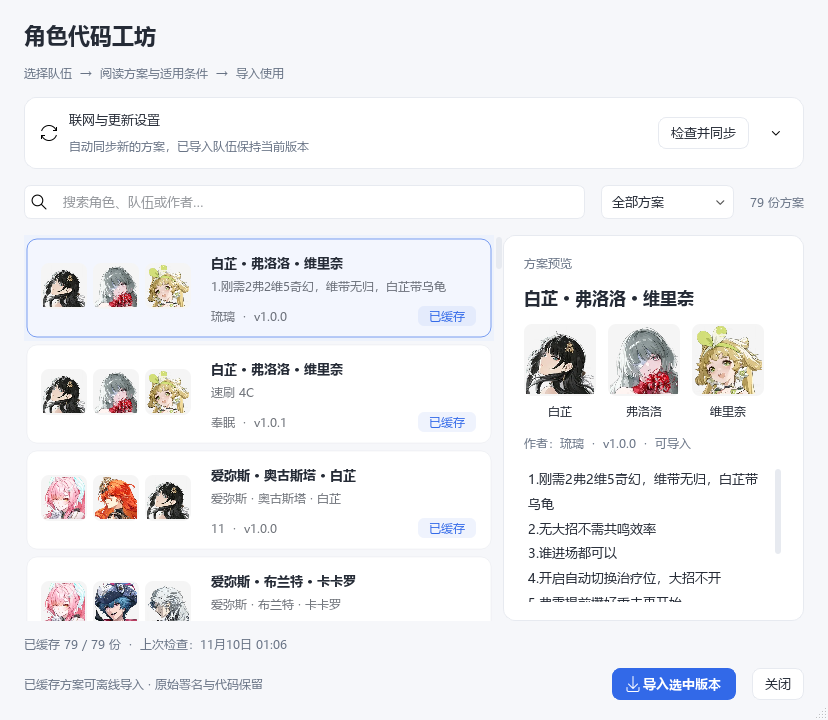

# 角色代码工坊

内置连招由 C++ 执行，工坊连招由独立 Python 进程执行。两种模式按队伍切换，采集画面和盒子输入仍由主程序统一管理。

兼容 OK-WW / OK-WW-E 的标准 Python 队伍 ZIP：压缩包根目录包含 `team.json` 和三名角色的 `.py` 文件。保留原脚本和作者信息，无需转换为 C++；导出的队伍 ZIP 也沿用这一格式。

## 导入和使用

1. 从 OK-WW / OK-WW-E 工坊下载队伍 ZIP，无需解压。
2. 暂停任务，在「角色代码」导入 ZIP，选择对应队伍。
3. 选择成员可查看、编辑该角色的 Python 源码；点击保存会校验后写入。
4. 将队伍切换到工坊代码，再启动自动战斗。

切回内置代码后使用 C++ 连招，导入的 Python 副本仍保留，之后可以再次启用。导出 ZIP 可保存队伍的代码与说明；工坊按钮打开内嵌代码库，可搜索队伍、作者和版本，选择版本后直接导入。

切换在后台执行，期间显示“正在切换队伍代码”。同一次软件运行中复用工坊管理环境，首次加载需要稍等；每次切换仍检查当前代码和用户依赖，失败时恢复该队伍的原文件。等待完成后再启动任务，退出软件也会先等待切换结束。

切换模式、保存或导入队伍后会清除上次队伍检测结果，运行栏显示「队伍配置已更新 · 下次启动重新识别」。下次启动重新创建战斗上下文，识别游戏内队员、当前角色和代码模式，不会沿用旧战斗状态。

### C++ 队伍包

「角色代码」也支持 `.okww-team` 原生队伍包，包含按本项目接口编译的模块、版本清单和源码。它与 Python ZIP 是两种格式。单独的 `.cpp`、`.c` 文件或任意 DLL 无法直接导入；修改 C++ 草稿后需要重新编译打包。

## 兼容范围

沿用现有 `BaseChar` 角色类与队伍结构。使用受支持角色和接口的 Python 队伍不需要编译 C++。键盘、鼠标按键、移动及截图请求通过桥接交给原生主程序；不会另开一套采集设备或自动任务循环。

额外依赖、未适配的框架接口、直接调用本机键鼠的第三方库，以及新增但尚未识别的角色，可能需要单独适配。输入能力还受盒子型号、固件和路由限制。遇到错误时保留队伍版本、操作步骤与相关日志，便于重现。

工坊 Python 具有普通进程权限，不是安全沙箱。请只导入可信来源的代码。第三方脚本的署名和许可随原文件保留，普通完整包不预装个人导入队伍。

## 执行边界与状态

C++ 管理采集、盒子输入、暂停和任务生命周期。工坊连招执行期间，Python 管理作者自定义状态、角色切换、协奏、变奏和冻结补偿；在连招片段入口、退出、重置和战斗结束时交换通用状态。通用状态包含切人、技能、增益时间和冻结时间线，以相对时间传递。角色自定义连招与私有字段不由 C++ 改写。

工坊使用当前宿主任务对应的 Python 任务对象，保留对 `AutoCombatTask`、`FarmEchoTask` 等类型和任务名称的原有判断。战斗结束只调用当前角色一次 `on_combat_end()`，再重置各角色状态；工坊模式不再重复执行内置角色的结束回调。暂停或异常时终止对应 Python 子进程并释放输入，后续启动使用新会话。

主程序启动工坊时检查桥接协议版本、工坊 API 版本和必要能力；请求携带会话及递增序号，过期请求和回复不会继续执行。完整包仍携带便携 Python，并校验运行库文件哈希。内置与工坊的角色基类有各自实现，修改通用行为时应同时验证两边；协议检查不代表任意第三方依赖都已兼容。

「任务」和「实时触发」上方状态栏显示识别到的队伍、当前角色，以及内置 C++ / Python 工坊模式。暂停后显示“上次识别”，不把缓存当作实时结果。鼠标停在队伍信息上可查看工坊启动耗时、空请求往返中位数与 P95、图像请求与复制次数，以及取帧到输入请求的间隔。该间隔包含脚本主动等待，仅用于定位软件开销，不代表采集卡、盒子或游戏的端到端延迟。

同一采集帧的重复请求复用图像副本；新帧通过共享内存传递，Python 保留独立字节数据，避免后续画面改写脚本持有的旧图像。

## 自动同步与离线代码库

工坊默认使用[原工坊公开抢救镜像](https://github.com/yamadafz/ok-ww-char-code)的[全量索引](https://raw.githubusercontent.com/yamadafz/ok-ww-char-code/main/teams.json)。该镜像保留原队伍源码、作者、版本和说明，是社区保存的快照。2026-11-10 核查时，原工坊仓库公开访问返回 404，旧站 `cfokwwchar.ok-script.com` 与 `okwwcharcode.ok-script.com` 均未能通过正常 HTTPS 连接，镜像与索引可访问；详见[项目链接与上游动态](project-links.md)。

工坊提供“联网自动同步”开关和 1 至 720 小时的更新周期，默认 24 小时。软件启动和保持运行时都会按周期检查，也可随时点击“检查并同步”。周期可用滑块或直接输入小时数调整，点击“保存设置”后生效。同步会下载索引中的全部版本到个人数据目录 `workshop-library/`，保留原作者、版本和描述；已下载的代码可离线导入。网络或证书失败时显示具体原因，保留本地内容，点击“下载全部 / 重试”可继续下载。自动同步检查的是所配置的索引，镜像没有新增内容时不会产生新方案。

同步不会自动改写正在使用的队伍。选中版本并点击“导入选中版本”后，确认队伍信息，才会通过原有导入流程替换同队伍的工坊代码；旧版本保留一份导入备份。可关闭自动同步，也可配置兼容原版 `teams.json` 的 GitHub 仓库或索引地址。更换源时不会删除已下载的压缩包。单次同步限两分钟，代码库存储上限 500 MB；未完成的下载可重试。

下载只检查 ZIP 结构、Python 语法和队伍信息，不执行角色代码。受支持的角色与 API 仍由当前软件决定，下载成功不代表新角色已完成适配。

代码库保存来源、作者、版本和文件校验信息。镜像是社区快照，新增内容取决于所配置的索引；下载和加载校验不等同于逐队完成游戏内测试。

支持增强版的锁瞑（Suoming）、秋水、凌阳、灯灯和普通秧秧，包含内置连招、Python 工坊角色类、识别素材和头像。各角色来源版本见[来源与组件说明](../THIRD-PARTY-DUALPC.md)。

内置锁瞑默认作为副输出，解放后传递增益并切人；在「角色设置」开启「锁瞑主C模式」后继续站场输出。工坊模式按所导入作者的连招执行。未来出现本项目尚不支持的角色时，仍会显示“角色待适配”，补齐角色后才能导入。

选中“角色待适配”方案，右侧会显示「提醒作者更新」和「复制反馈信息」。提醒按钮打开邮件客户端，预填收件人 `lidada0202@gmail.com`、队伍、方案作者与版本、缺失角色和软件版本，查看后自行发送。未配置邮件客户端时会复制反馈信息，也可直接使用复制按钮手动发送。反馈内容不包含个人配置、盒子凭据或日志。

## 浏览与中文显示

工坊按“头像方案卡片 + 完整说明”展示。每份方案展示三名队内角色的头像、中文名、方案标题、作者和版本；右侧放大展示队伍成员及使用说明。头像按原图等比显示，暂无头像的角色使用中文占位。支持中文角色名、英文原名、作者、版本与说明搜索，可筛选全部、已缓存、当前可导入或角色待适配方案。选中后在右侧阅读完整使用条件和说明，不必在狭窄表格里查看长文字；联网设置可展开调整。

队伍名、方案名和常用说明词汇以中文显示。作者账号、链接、版本号、按键符号和代码标识保持原样，便于追溯来源。汉化只影响展示，不修改下载 ZIP、Python 源码、导入标识或原作者署名。
